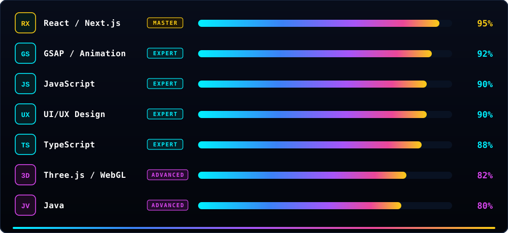

  

  <code>$ peter-parker --suit: STARK_UPGRADE · Creative Web Developer / Spider-Verse UI _</code>

---

  <code>🧬 &gt; whoami</code>

  

  

 

  <code>🧪 &gt; sudo install --tech-stack</code>

  

 

  <code>🕹️ &gt; skill_tree.exe</code>

  

 

  <code>📊 &gt; hero_stats.sys</code>

  

 

  <code>📡 &gt; connect_with_me</code>

  

 

  <code>🚀 &gt; featured_builds --live</code>

  

