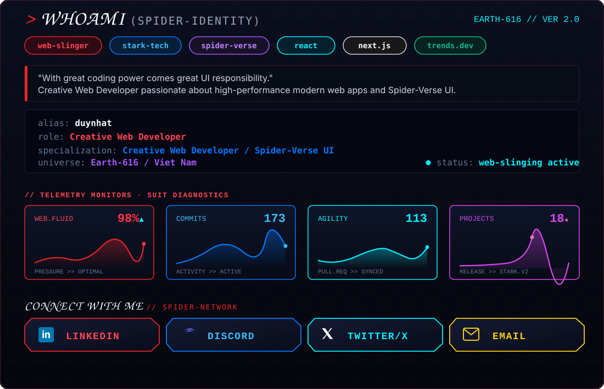
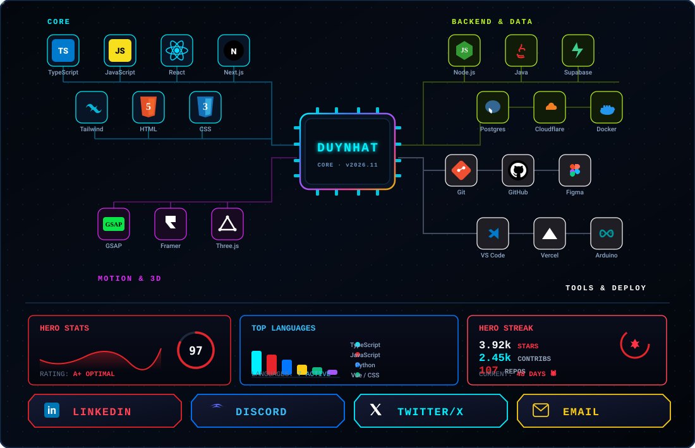

  

  <code>$ peter-parker --suit: STARK_UPGRADE · Creative Web Developer / Spider-Verse UI _</code>

---

<table border="0" width="100%" cellpadding="0" cellspacing="0">
  <tr border="0">
    <td width="49%" valign="top">
      
    </td>
    <td width="2%"></td>
    <td width="49%" valign="top">
      
    </td>
  </tr>
</table>

 

  

