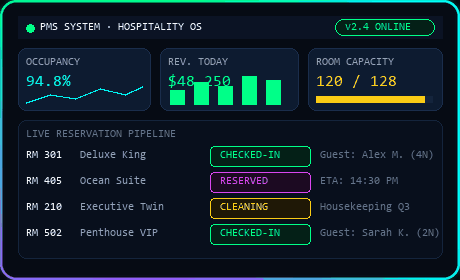
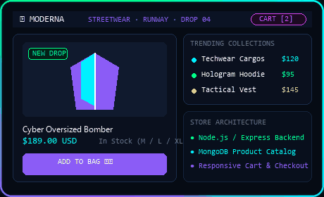
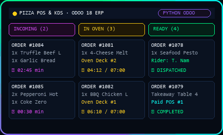

  

  <code>$ peter-parker --suit: STARK_UPGRADE · Creative Web Developer / Spider-Verse UI _</code>

---

  <code>🧬 &gt; whoami</code>

  

  

 

  <code>🧪 &gt; sudo install --tech-stack</code>

  

 

  <code>🕹️ &gt; skill_tree.exe</code>

  

 

  <code>📊 &gt; hero_stats.sys</code>

  

 

  <code>📡 &gt; connect_with_me</code>

  

 

  <code>🚀 &gt; featured_builds --live</code>

<table border="0" width="100%" cellpadding="0" cellspacing="12">
  <tr valign="top">
    <td width="33.3%" align="left">
      
        
      <b>PMS System</b> 
      Hospitality &amp; Property Management System
        
      
      
      
      
      
      
        
      <a href="https://github.com/nguyenduynha/PMS-system"><b>Source Code ↗</b></a> &nbsp;|&nbsp; Demo: Staging
    </td>
    <td width="33.3%" align="left">
      
        
      <b>MODERNA Clothing Store</b> 
      Fashion eCommerce Storefront &amp; Cart
        
      
      
      
      
      
      
        
      Source: Private &nbsp;|&nbsp; Demo: In Development
    </td>
    <td width="33.3%" align="left">
      
        
      <b>Pizza Management System</b> 
      Enterprise Restaurant ERP &amp; Kitchen KDS
        
      
      
        
      Source: Enterprise &nbsp;|&nbsp; Demo: On-Premise
    </td>
  </tr>
</table>
